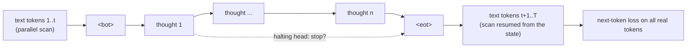
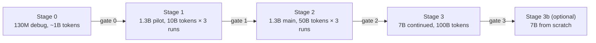

# Training Latent Mamba to 7B

How to take Latent Mamba from the 130M fine-tuning result in the [paper](paper.pdf) to a 7B model that learns to think in continuous space **during pretraining**, not only during fine-tuning.

**Recommendation.** Validate latent pretraining by continuing to pretrain the public Mamba-2 1.3B checkpoint with thoughts switched on, against two controls. If it beats them, run the same recipe at 7B, starting from an existing 7B Mamba-2 checkpoint, and only pretrain a 7B from scratch if that result justifies a six-figure compute budget.

| Stage | What | Hardware | Compute cost |
|---|---|---|---|
| 0 | Debug the trainer on Mamba-2 130M, ~1B tokens | 1 node, 8×H100 | ~$20 |
| 1 | 1.3B pilot, 10B tokens, three runs | 1 node, 8×H100 | ~$0.6–1k |
| 2 | 1.3B main, 50B tokens, three runs | 1 node, 8×H100 | ~$2–5k |
| 3 | 7B continued pretraining from an existing 7B checkpoint, 100B tokens | 8 nodes, 64×H100 | ~$25–45k |
| 3b | (optional) 7B from scratch with latent pretraining, 1T tokens | 16 nodes, 128×H100 | ~$75–90k+ |

All costs assume $2.50–3 per H100-hour and are estimates, not measurements (Section 8 explains how they are computed).

---

## 1. Goals

The 130M results show that a Mamba-2 can learn to reason in latent space when *fine-tuned* with the Coconut curriculum: 99.0% on ProsQA against 74.6% for the same model answering directly, and the thought ablations show the thoughts carry the information. They leave four questions open:

1. **Does it scale?** Does the gain hold, grow or vanish at 1.3B and 7B?
2. **Does it work on hard reasoning?** On GSM8k, Coconut trailed written chain of thought at GPT-2 scale. ProsQA is saturated and cannot answer this.
3. **Can thinking be learned in pretraining?** Instead of bolting thoughts on at fine-tuning, insert them into ordinary pretraining text and let the next-token loss teach the model to use them.
4. **Is it the content of the thoughts, or just extra compute?** A trained pause-token control answers this directly, which the 130M paper could only approximate with test-time ablations.

The program succeeds if a latent-pretrained model, after the same downstream fine-tuning, beats both controls on GSM8k at 1.3B, and the gap holds or grows at 7B.

## 2. Where we are

| | Value |
|---|---|
| Model | Mamba-2 130M (`state-spaces/mamba2-130m`), fine-tuned |
| ProsQA test accuracy | 99.0% (6 thoughts), 98.6% (learned halting, 3.1 thoughts) |
| Baselines | 74.6% no CoT, 70.8% written CoT |
| Thought ablations | 73.6% none, 76.8% zeros, 75.8% noise |
| State size | 18.2 MiB at any budget up to 4,096 thoughts |
| Known weaknesses | one seed, one synthetic task; halting barely adapts to difficulty; thoughts run 3–5× slower than GPT-2 decoding in the reference implementation |

Checkpoints are on [Hugging Face](https://huggingface.co/kye/latent-mamba) and training curves on [W&B](https://wandb.ai/apacai/latent-mamba).

## 3. Paths to 7B

| Path | Start from | Pros | Cons | Verdict |
|---|---|---|---|---|
| **A. Continue pretraining at 7B** | [`mistralai/Mamba-Codestral-7B-v0.1`](https://huggingface.co/mistralai/Mamba-Codestral-7B-v0.1) or [`nvidia/mamba2-8b-3t-4k`](https://huggingface.co/nvidia/mamba2-8b-3t-4k) | 10–20× cheaper than from scratch; strong base | Codestral is code-heavy; NVIDIA's is Megatron format only; both use 8 B/C groups | **Recommended** after the 1.3B result |
| B. Pretrain 7B from scratch | random init | full control of data, tokenizer and architecture; thoughts from step zero | $75k+ for a competitive token count | Only if A shows a large effect |
| C. Grow 1.3B into 7B | `state-spaces/mamba2-1.3b` | reuses the 1.3B pilot | growth methods are proven for about 2×, not 5×, and untested for SSMs | Not recommended |

[`tiiuae/falcon-mamba-7b`](https://huggingface.co/tiiuae/falcon-mamba-7b) is Mamba-1, not Mamba-2, so it does not fit this architecture.

The 1.3B stage starts from [`state-spaces/mamba2-1.3b`](https://huggingface.co/state-spaces/mamba2-1.3b) (300B Pile tokens), which already loads into `latent_mamba/main.py` without renaming.

## 4. Models

| | 1.3B (stages 1–2) | 7B (stage 3) |
|---|---|---|
| Base checkpoint | `state-spaces/mamba2-1.3b` | `Mamba-Codestral-7B-v0.1` (or NVIDIA 8B) |
| Layers | 48 | 64 |
| Width `d_model` | 2048 | 4096 |
| Inner width (expand 2) | 4096 | 8192 |
| Heads × head dim | 64 × 64 | 128 × 64 |
| State size `N` | 128 | 128 |
| B/C groups | 1 | 8 |
| Vocabulary | 50,277 (GPT-NeoX) | 32,768 (Mistral v3) |
| Parameters | ~1.34B | ~7.3B |
| Added by Latent Mamba | thought projector + halting head, ~0.2% | ~0.1% |
| Training context | 4,096 | 4,096 |

**Pure or hybrid.** NVIDIA's 8B study found pure Mamba-2 lags Transformers on in-context recall and 5-shot MMLU, while a hybrid with about 7% attention layers beats both. A hybrid is the stronger base model, but thoughts must then be kept out of the attention layers' KV cache, or the constant-memory property is lost. This plan stays pure Mamba-2, consistent with the paper; a hybrid is a separate follow-up (Section 12).

## 5. Latent pretraining objective

The core idea: take ordinary pretraining sequences, open a few thought spans inside them, and train with the ordinary next-token loss. The thoughts receive gradient only through how well the model predicts the text after them, so they learn to carry whatever helps prediction. No written chain of thought is needed.

### 5.1 Thought insertion

1. **Positions.** K insertion points per 4,096-token sequence (start with K = 4), drawn at random, **identical across the batch**, so each thought step is one batched pass rather than many separate ones.
2. **Budget.** n thoughts per span, drawn per batch from 1 to 8 (the recurrent-depth training of Geiping et al. samples its iteration count the same way), so the model learns to use any budget.
3. **Mechanics.** Scan the text up to the insertion point, run `<bot>`, then n calls of `thought_step`, then `<eot>`, then resume the scan from the resulting state. `main.py` already supports every piece: the chunked scan accepts an initial state, and `thought_step` takes and returns the state.
4. **Loss.** Standard next-token cross-entropy on every real token. `<bot>`, `<eot>` and thought positions produce no loss.

**Cost.** K × n ≈ 16 sequential single-token steps per sequence, against one parallel scan of 4,096 tokens. With the fused single-step kernel (Section 7) we expect about 20–30% overhead; without it, more. Measure this in stage 0.

### 5.2 Halting

Learned halting is switched on for the second half of each run. At each insertion point, after taking N = 8 thoughts, the states after thought 1, 2, …, N are concatenated along the batch axis, and the next 32 tokens are scored from all of them in one pass: the paper's batched PonderNet loss, applied to a short window of text instead of an answer. This adds about 20% compute in that half. The halting head then learns where extra thoughts stop helping prediction.

### 5.3 Curriculum on reasoning traces

About 15% of the mix is reasoning data with explicit steps (question, steps, answer). For these, thought spans are placed where the steps are, and the written steps are dropped progressively over training, exactly as in the paper's curriculum (`layout()` in `train.py`). This connects the self-supervised thoughts on web text to the supervised use on reasoning.

### 5.4 Three runs on identical data

| Run | Thought spans | Thought content | Answers |
|---|---|---|---|
| **Latent** | yes | real | the technique |
| **Pause control** | yes, same positions and counts | zeroed (only the mode embedding) | is it the content or the extra compute? |
| **Plain control** | none | – | is it just more pretraining on this mix? |

All three use the same data order, steps and schedule. At 7B, the plain control can be dropped if the 1.3B stage was conclusive, saving a third of the cost.

### 5.5 Thought utility

The early warning that the model is ignoring its thoughts: on a held-out set, the loss on the 32 tokens after each span with real thoughts minus the same loss with zeroed thoughts. It is logged every evaluation. If it stays at zero for the first few billion tokens, stop and fix the objective before spending more.

## 6. Data

| Share | Source | Approx. size | Purpose |
|---|---|---|---|
| 50% | [FineWeb-Edu](https://huggingface.co/datasets/HuggingFaceFW/fineweb-edu) (or [DCLM-baseline](https://huggingface.co/datasets/mlfoundations/dclm-baseline-1.0)) | ~1.3T (DCLM ~4T) | general text, and replay against forgetting |
| 20% | [FineMath](https://huggingface.co/datasets/HuggingFaceTB/finemath), [OpenWebMath](https://huggingface.co/datasets/open-web-math/open-web-math), [Proof-Pile-2](https://huggingface.co/datasets/EleutherAI/proof-pile-2) | ~50B, ~15B, ~55B | mathematics |
| 15% | [The Stack v2](https://huggingface.co/datasets/bigcode/the-stack-v2) | very large | code; gated, and it lists file IDs, so contents are downloaded separately |
| 15% | [MetaMathQA](https://huggingface.co/datasets/meta-math/MetaMathQA), [OpenMathInstruct-2](https://huggingface.co/datasets/nvidia/OpenMathInstruct-2), [NuminaMath-CoT](https://huggingface.co/datasets/AI-MO/NuminaMath-CoT), GSM8k-Aug | ~0.4M, ~14M, ~0.9M, ~0.4M examples | reasoning traces for the curriculum (5.3) |
| optional | [peS2o](https://huggingface.co/datasets/allenai/peS2o) | ~40B | scientific papers, longer documents |

Sizes are approximate. Hold out the GSM8k, MATH and ProsQA **test** sets from everything, and decontaminate the mix against them by n-gram overlap.

- **Tokenizer.** Keep the base checkpoint's tokenizer: GPT-NeoX at 1.3B, Mistral v3 at 7B. `<bot>`, `<eot>` and padding use spare or newly added embedding rows, initialised as in `build_mamba`.
- **Processing.** Filter, deduplicate and tokenise with [datatrove](https://github.com/huggingface/datatrove), into fixed-size shards of uint16 token IDs (both vocabularies fit in 16 bits).
- **Storage.** About 2 GB per billion tokens tokenised: 20 GB for the 10B pilot, 100 GB for 50B, 200 GB for 100B. Keep raw downloads off the training volume.
- **Reasoning traces** are stored separately as question, steps and answer, so the curriculum can drop steps on the fly.

## 7. Engineering

A new `latent_mamba/pretrain.py`, separate from the fine-tuning pipeline in `train.py`.

| Component | 1.3B | 7B | Notes |
|---|---|---|---|
| Parallelism | data parallel; ~21 GB of weights, gradients and AdamW state fit on every GPU | FSDP2 (`fully_shard`); ~117 GB of state, ~2 GB per GPU on 64 GPUs | 16 bytes per parameter for fp32 master weights, gradients and Adam moments |
| Precision | bf16 autocast, scan in float32 | same | as in `train.py` |
| Sequence scan | `mamba_ssm` fused chunked scan | same | already the default on CUDA, checked against the reference at startup |
| Thought steps | `mamba_ssm` `selective_state_update` fused single-step kernel + CUDA graphs for the thought loop | same | **new**; the main speed lever, verified against `ssd_step` at startup like the scan |
| B/C groups | 1 (works today) | 8 | **new** in `main.py`; the memory-saving scan rewrite assumes 1 group; verify against the reference recurrence |
| Checkpoint loading | `state-spaces` format (works today) | HF Transformers `Mamba2ForCausalLM` format (Codestral); Megatron conversion (NVIDIA) | **new** loaders; names differ slightly (`embeddings` vs `embedding`) |
| Activation memory | checkpoint each layer, per segment between thought spans | same | as in `enable_grad_checkpointing` |
| Data loading | memory-mapped token shards, mixing by proportion, deterministic order per seed | same | resumable mid-epoch |
| Checkpoints | full state every hour + at the end | `torch.distributed.checkpoint`, sharded | upload to Hugging Face, as now |
| Logging | W&B: loss, thought utility, tokens/s, utilisation | same | as now |

**Training settings** (starting points, to be tuned in stage 0–1):

| Setting | 1.3B | 7B |
|---|---|---|
| Global batch | ~1M tokens (256 × 4,096) | ~4M tokens (1,024 × 4,096) |
| Peak learning rate | 2e-4 | 1e-4 |
| Schedule | warmup 1% then warmup–stable–decay, decay over the last 20% | same |
| Optimiser | AdamW, β = (0.9, 0.95), weight decay 0.1, clip 1.0 | same |
| Thought spans | K = 4 per sequence, n ∈ [1, 8] | same |
| Halting | second half; window 32 tokens; prior λp = 0.2, β = 0.01 | same |

The learning rate is re-warmed because the base checkpoints finished their own schedules. Watch held-out loss on general text in the first billion tokens: a jump means the peak is too high.

## 8. Compute, GPUs and cost

Training compute is estimated as 6 × parameters × tokens, at about 40% utilisation of an H100's bf16 peak (~400 TFLOP/s effective), then increased for the sequential thoughts and halting. These are estimates; stage 0 measures the real throughput.

### 8.1 1.3B continued pretraining (one 8×H100 node)

| Tokens per run | Base H100-hours | With 30–100% thought overhead | Wall clock on 8×H100 | Cost per run | Three runs |
|---|---|---|---|---|---|
| 10B (pilot) | ~54 | ~70–110 | ~9–14 h | ~$200–330 | ~$0.6–1k |
| 50B (main) | ~270 | ~350–540 | ~2–3 days | ~$0.9–1.6k | ~$2.7–4.8k |

One node of **8×H100 SXM** (NVLink) is enough at 1.3B. Prefer SXM over NVL for the faster links between GPUs.

### 8.2 7B continued pretraining from an existing checkpoint (stage 3)

| Tokens per run | H100-hours (incl. overhead) | Wall clock | Cost per run |
|---|---|---|---|
| 50B | ~2,000–3,000 | 64×H100, ~1.5–2 days | ~$5–9k |
| 100B | ~4,000–6,000 | 64×H100, ~2.5–4 days | ~$10–18k |

Latent and pause runs at 100B tokens: about **$25–45k** including restarts and evaluation.

### 8.3 7B from scratch (optional stage 3b)

| Tokens | Comparable to | H100-hours | Wall clock | Cost |
|---|---|---|---|---|
| 140B | compute-optimal (Chinchilla) | ~4,100 | 64×H100, ~2.7 days | ~$10–12k |
| 500B | solid research model | ~14,600 | 128×H100, ~4.7 days | ~$37–44k |
| 1T | good research 7B | ~29,000 | 128×H100, ~9.5 days | ~$73–88k |
| 2T | near NVIDIA's Mamba2-8B (3.5T) | ~58,000 | 256×H100, ~9.5 days | ~$146–175k |

Add 20–50% for restarts, evaluation and the latent phase. From scratch, the cheapest fair control is a fork: train one base on ~90% of the tokens, then branch latent and plain runs for the last ~10%, so the control costs ~10% extra instead of 100%.

### 8.4 Hardware

- **Multi-node runs need InfiniBand between nodes** (8×H100 SXM per node, 3.2 Tb/s). Separate pods without a fast interconnect waste most of the money. RunPod Instant Clusters, Lambda 1-Click Clusters, CoreWeave and Nebius offer this.
- **H200 (141 GB)** allows larger micro-batches at 7B and more room for the halting stage, which effectively multiplies the batch by N during scoring.
- **Storage:** a shared network volume of 1–2 TB for tokenised data and checkpoints (a 7B checkpoint with optimiser state is about 117 GB).

## 9. Scale ladder and decision gates

| Gate | Pass if | If it fails |
|---|---|---|
| 0 | trainer runs end to end; fused kernels match the reference; thought overhead measured and ≤ 2×; loss matches plain training when K = 0 | fix the trainer; do not scale |
| 1 | thought utility clearly above zero; latent ≥ pause on held-out loss after spans; no regression on general text | change the objective (positions, n, K, curriculum share) and rerun the pilot |
| 2 | after the same downstream fine-tuning, latent beats both controls on GSM8k by more than the seed-to-seed spread (3 seeds of fine-tuning) | publish the 1.3B result as is; do not spend on 7B |
| 3 | the 7B gain on GSM8k and MATH-500 holds or grows over 1.3B | stop; the effect does not scale |

## 10. Evaluation

**During pretraining** (every ~1B tokens):
- held-out loss on general text, maths and code, separately
- thought utility (5.5), and the loss after spans as a function of n
- halting: mean thoughts chosen, and how it varies with text type
- throughput in tokens/s and utilisation

**Base-model quality** with [lm-evaluation-harness](https://github.com/EleutherAI/lm-evaluation-harness), against the original checkpoint, so latent pretraining does not cost general ability: HellaSwag, ARC-Easy/Challenge, PIQA, WinoGrande, LAMBADA, and MMLU at 7B.

**Downstream**, with the existing `train.py` pipeline, for every pretrained model (latent, pause, plain, original):
- GSM8k test (main metric), MATH-500, SVAMP and ASDiv (generalisation), ProsQA and ProntoQA (sanity, should stay near 99%)
- thought ablations, budget sweep and halting by difficulty, as in the paper
- 3 fine-tuning seeds per model, with confidence intervals

**Efficiency:** state size, peak memory and latency against thinking budget, against a Transformer of the same size, with the fused kernels on (the paper's benchmark used the reference implementation).

## 11. Risks

| Risk | Sign | Mitigation |
|---|---|---|
| The model learns to ignore its thoughts | thought utility stays near zero | stop at gate 1; place spans at sentence and step boundaries; raise the reasoning-trace share; up-weight the loss right after spans |
| Thoughts are too slow to train at scale | measured overhead > 2× in stage 0 | fused single-step kernel and CUDA graphs first; fewer spans per sequence (K = 2) |
| Forgetting general ability | general-text loss and lm-eval scores drop | lower peak learning rate; more general-text replay; shorter re-warmup |
| Halting collapses to always stop or never stop | mean thoughts pinned at 1 or N | tune λp and β; enable halting later in training |
| Training instability at 7B | loss spikes | lower learning rate, longer warmup, gradient clipping, skip batches with abnormal gradient norm |
| Codestral is weak at maths | low GSM8k few-shot before any training | use NVIDIA's Mamba2-8B (needs Megatron conversion) |
| Evaluation contamination | suspiciously high test scores | n-gram decontamination of the whole mix against all test sets |
| Cluster failures mid-run | lost hours | hourly sharded checkpoints, automatic resume (already the pattern in `train.py`) |

## 12. Timeline

| Weeks | Work | Spend |
|---|---|---|
| 1–3 | `pretrain.py`, data pipeline, fused single-step kernel; stage 0 on 130M | ~$100 |
| 4 | stage 1: 1.3B pilot, three runs; downstream fine-tuning | ~$1–1.5k |
| 5–6 | stage 2: 1.3B main, three runs; downstream with 3 seeds; write up | ~$3–6k |
| 5–8 (parallel) | 8-group support, HF and Megatron loaders, FSDP2; validate on 2.7B | ~$500 |
| 9–11 | stage 3: 7B continued pretraining; downstream evaluation | ~$25–45k |
| later | stage 3b (optional): 7B from scratch | $75k+ |

## 13. Open decisions

1. **Budget ceiling for stage 3**, which sets the token count (50B or 100B) and whether the plain control runs at 7B.
2. **7B base:** Codestral Mamba (easy to load, code-heavy) or NVIDIA Mamba2-8B (more general, needs conversion). Check both on GSM8k few-shot before choosing.
3. **Pure Mamba-2 or hybrid** for any from-scratch run.
4. **Compute provider** for multi-node runs (RunPod Instant Clusters, Lambda, CoreWeave or Nebius).
5. **Release policy:** public checkpoints at every stage, as now, or only after the 7B result.

## References

- Hao et al., *Training Large Language Models to Reason in a Continuous Latent Space* (Coconut), 2024
- Dao and Gu, *Transformers are SSMs* (Mamba-2), 2024
- Banino et al., *PonderNet: Learning to Ponder*, 2021
- Goyal et al., *Think before you speak: Training Language Models With Pause Tokens*, 2024
- Zelikman et al., *Quiet-STaR*, 2024
- Geiping et al., *Scaling up Test-Time Compute with Latent Reasoning: A Recurrent Depth Approach*, 2025
- Waleffe et al., *An Empirical Study of Mamba-based Language Models*, 2024
- Hoffmann et al., *Training Compute-Optimal Large Language Models* (Chinchilla), 2022
- Penedo et al., *The FineWeb Datasets*, 2024
- Gomez, [*Latent Mamba: Adaptive Continuous Reasoning in Constant Memory*](paper.pdf), 2026
